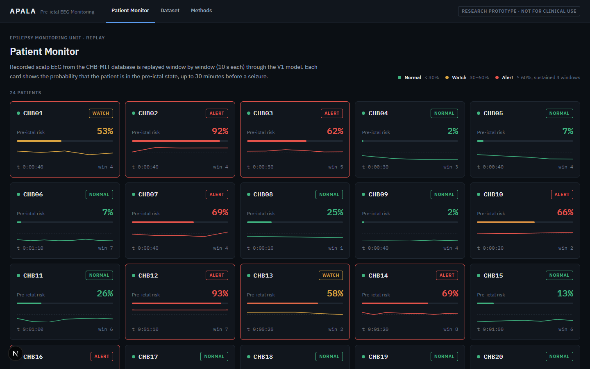
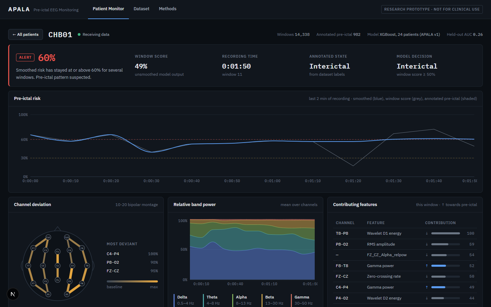
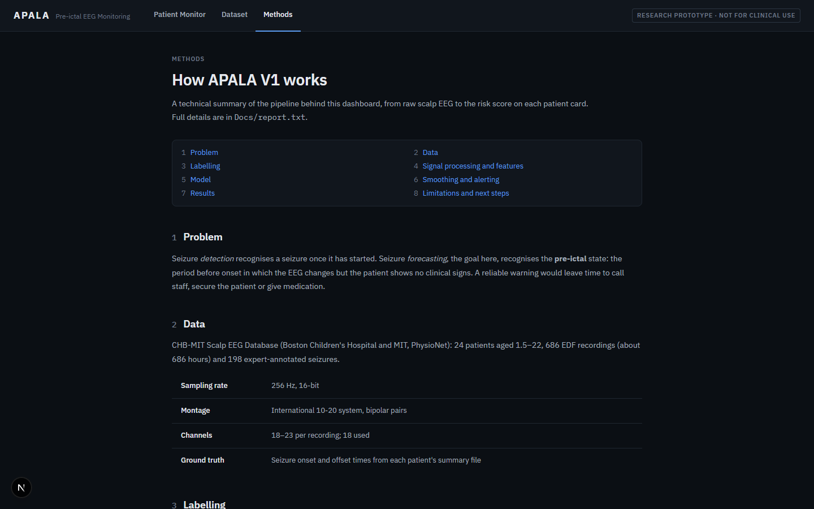
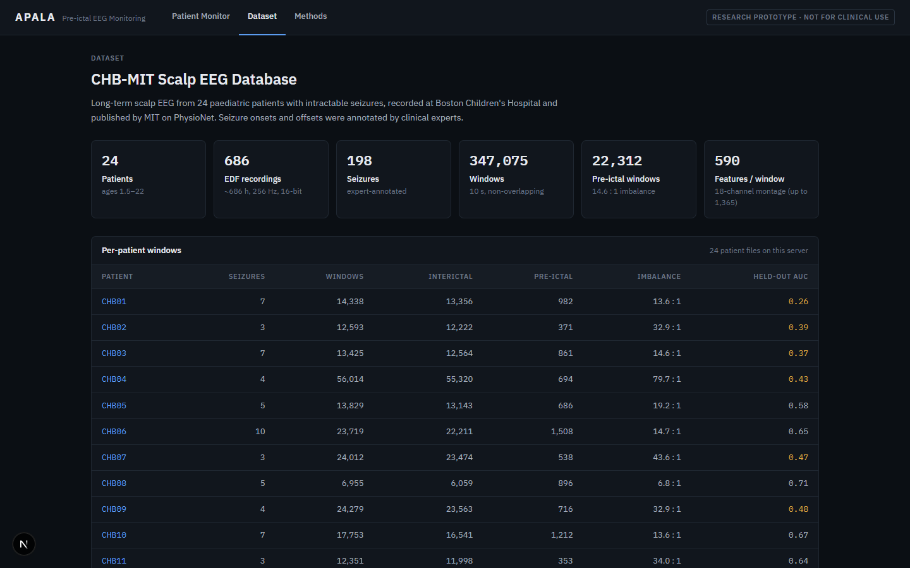

<h1 align="center">APALA(v1)</h1>

<p align="center"><b>Patient-Independent Pre-Ictal EEG Detection</b><br>
<sub>formerly <b>NeuroPulse</b></sub></p>

<p align="center">
  CHB-MIT EEG · 24 patients · 198 seizures · 347,075 windows · 30-minute warning horizon · FastAPI + Next.js live dashboard
</p>

<p align="center">
  
  <br>
  <sub>The live monitor: every patient's seizure risk, streamed in real time</sub>
</p>

APALA is a seizure **forecasting** system for hospital Epilepsy Monitoring Units. It reads scalp EEG, looks for
the *pre-ictal* brain state (the up to 30 minutes before a seizure begins) and streams a live risk score to a
clinical dashboard. It is not a seizure *detector*, which only fires once a seizure has already started.

This repository holds the working system, **V1**: a full EEG pipeline, a GPU-trained stacking ensemble, a
real-time backend and a dashboard. It also tells the story of why the project is being rebuilt under a new name.

---

## By the numbers

| | |
|:---|:---|
| **Patients** | 24 children and young adults (ages 1.5–22), Boston Children's Hospital |
| **Recordings** | 686 EDF files, ~686 hours of continuous EEG, ~40 GB raw |
| **Seizures** | 198 clinically annotated seizures |
| **Signal** | 256 Hz, 16-bit, 18–23 bipolar channels (10-20 system) |
| **Windows** | 347,075 labelled 10-second windows (2,560 samples per channel each) |
| **Class balance** | 324,763 normal vs 22,312 pre-ictal windows (14.6 : 1) |
| **Features** | 590 per window for an 18-channel recording, up to 1,365 |
| **Ensemble** | XGBoost (500 trees, GPU) + LightGBM (500) + Random Forest (300) → Logistic Regression |
| **Speed-ups** | Sample Entropy 695 ms → 4.4 ms per window with Numba (**158×**); all 686 files processed in ~40 min with 20 workers |
| **Models** | 47.9 MB stacking ensemble (research); 3.4 MB XGBoost on all 24 patients (590 features) serving the live dashboard |
| **Live system** | 6 API endpoints, WebSocket stream per patient, patient monitor, 10-20 electrode map, dataset and methods pages |

---

## Results

V1 was measured in four ways. They give very different numbers, and the difference is the most important
thing this project learned.

| Evaluation | ROC-AUC | Sensitivity | Specificity | False alarms | What it means |
|:---|:---:|:---:|:---:|:---:|:---|
| **One known patient** (chb01, 14,338 windows) | 0.998 | 94.3% | 99.5% | 0.5% | Trained and tested on the same patient |
| **Ensemble evaluation** (3,585 windows) | 0.993 | 92.3% | 97.6% | 2.4% | 227 of 246 pre-ictal windows caught, 81 false alarms |
| **Unseen patients** (train chb01–10 → test chb11–24) | 0.595 | 5.7% | 98.1% | 1.9% | Patients the model has never seen |
| **Leave-one-patient-out**, all 24 patients | 0.56 mean · 0.59 median | 27.9% | 77.7% | — | Each patient scored by a model trained on the other 23 |

On patients it already knows, V1 is very strong. On new patients it is only slightly better than chance (0.5),
and the per-patient results range from 0.26 to 0.71. chb01, which scores 0.998 when the model has seen it, scores
0.26 when it hasn't. The 0.5 decision threshold also doesn't transfer: sensitivity ranges from 0% to 86% between
patients. That gap is normal in seizure prediction, because every brain is different, and it is exactly the
problem APALA sets out to solve.

<details>
<summary><b>Leave-one-patient-out results per patient</b> (XGBoost, 590 features, 500 trees)</summary>

| Patient | Windows (pre-ictal) | ROC-AUC | PR-AUC | Sensitivity | Specificity |
|:---|---:|---:|---:|---:|---:|
| chb01 | 14,338 (982) | 0.259 | 0.043 | 1.6% | 79.2% |
| chb02 | 12,593 (371) | 0.387 | 0.022 | 6.2% | 87.2% |
| chb03 | 13,425 (861) | 0.367 | 0.047 | 0.0% | 99.8% |
| chb04 | 56,014 (694) | 0.435 | 0.012 | 1.7% | 99.2% |
| chb05 | 13,829 (686) | 0.584 | 0.095 | 32.8% | 84.3% |
| chb06 | 23,719 (1,508) | 0.652 | 0.089 | 32.7% | 78.6% |
| chb07 | 24,012 (538) | 0.470 | 0.020 | 6.9% | 88.8% |
| chb08 | 6,955 (896) | 0.706 | 0.197 | 47.1% | 73.3% |
| chb09 | 24,279 (716) | 0.475 | 0.033 | 17.6% | 85.2% |
| chb10 | 17,753 (1,212) | 0.671 | 0.155 | 3.1% | 99.7% |
| chb11 | 12,351 (353) | 0.643 | 0.040 | 57.2% | 59.5% |
| chb12 | 7,422 (1,814) | 0.536 | 0.328 | 62.4% | 36.9% |
| chb13 | 11,464 (1,113) | 0.610 | 0.143 | 68.5% | 44.8% |
| chb14 | 9,096 (1,246) | 0.522 | 0.147 | 34.4% | 70.1% |
| chb15 | 13,630 (1,750) | 0.556 | 0.161 | 0.4% | 99.9% |
| chb16 | 6,526 (985) | 0.431 | 0.123 | 32.6% | 54.2% |
| chb17 | 7,440 (537) | 0.669 | 0.101 | 19.6% | 84.5% |
| chb18 | 12,652 (816) | 0.674 | 0.110 | 13.0% | 94.1% |
| chb19 | 10,678 (387) | 0.693 | 0.141 | 41.3% | 89.4% |
| chb20 | 9,657 (856) | 0.673 | 0.198 | 86.3% | 30.5% |
| chb21 | 11,674 (665) | 0.648 | 0.080 | 37.1% | 75.8% |
| chb22 | 11,060 (484) | 0.680 | 0.079 | 48.1% | 76.3% |
| chb23 | 9,299 (947) | 0.595 | 0.132 | 1.5% | 99.2% |
| chb24 | 7,209 (1,895) | 0.498 | 0.246 | 18.5% | 75.0% |
| **Mean** | | **0.560** | **0.114** | **27.9%** | **77.7%** |
| **Median** | | **0.590** | **0.105** | | |

Sensitivity and specificity at a 0.5 threshold. Missing channels (chb12–chb22 lack the right-temporal chain in
many recordings) are left as missing values, which XGBoost handles natively. Full results:
`V1_Classical_ML/models/trained/apala_xgb_v1_lopo.json`.
</details>

<sub>Sources: <code>V1_Classical_ML/reports/model_results/</code> and <a href="Docs/report.txt"><code>Docs/report.txt</code></a> §8.</sub>

---

## From NeuroPulse to APALA

**1. NeuroPulse is built.** The project began as NeuroPulse: download the CHB-MIT database, verify all 686
files against their checksums, parse 24 differently formatted seizure annotation files, filter the signals
(0.5–50 Hz band-pass, 60 Hz notch), cut them into 347,075 windows and compute hundreds of features for each:
band powers, Hjorth parameters, wavelets, Sample Entropy, fractal dimension and cross-hemisphere coherence.

**2. The hard engineering.** Sample Entropy alone would have taken about 66 hours, so its inner loop was
compiled with Numba and became 158× faster. XGBoost silently fell back to the CPU inside scikit-learn's stacking
code, so the stacking was rewritten by hand to keep the RTX 5080 GPU busy. Flat electrodes crashed training with
infinite values, so three layers of clean-up were added. The result was a working, live, 47.9 MB model.

**3. The honest test.** Tested on the patients it was trained on, the model scored an ROC-AUC of 0.998. Tested
on 14 patients it had never seen, it scored 0.595 and caught only 5.7% of pre-ictal windows. A later
leave-one-patient-out run across all 24 patients confirmed it: a mean ROC-AUC of 0.56. A system for real
hospitals has to work on the *next* patient who walks in, not only on the ones it has already studied.

**4. A clean rebuild.** So the project was re-planned from the ground up around one research question: *can a
model learn a patient-independent representation of scalp EEG that recognises the pre-ictal state in a
previously unseen patient, with a low false-alarm burden?* The plan: leave-one-patient-out (LOPO) evaluation
across all 24 cases, every preprocessing step kept strictly inside the training folds to prevent leakage, honest
baselines first, and a multi-scale CNN with squeeze-and-excitation (SE) blocks and a KAN classification head.

**5. A new name.** A new research question deserved a new name. The project became **APALA**, in remembrance of
**Apālā Ātreyī** (अपाला आत्रेयी), a young woman to whom the Ṛgveda hymn 8.91 is traditionally attributed. In
the hymn she finds Soma by the path, offers it to Indra herself and asks for three things: growth for her
father's head, for his field and for her own body. Later tradition (the Jaiminīya Brāhmaṇa 1.220–221) tells of
a skin affliction and of her purification and transformation. Hers is a story of confronting affliction,
taking initiative and seeking change, and APALA tries to do the same for a neurological event: notice the change
early, so that something can be done before the seizure begins.

> The name is a cultural homage. Apālā is not documented as a physician or scientist, and whether she herself
> composed Ṛgveda 8.91 cannot be established with certainty.

The classical V1 system lives on in [`V1_Classical_ML/`](V1_Classical_ML). The dashboard runs its XGBoost model
trained on all 24 patients, and shows each patient's leave-one-patient-out score next to the live risk.

---

## The dashboard

<table>
  <tr>
    <td width="50%" valign="top" align="center">
      <br>
      <sub><b>Patient view:</b> live EEG risk trend, electrode map and the features behind each prediction</sub>
    </td>
    <td width="50%" valign="top" align="center">
      <br>
      <sub><b>How it works:</b> a built-in guide to brainwaves and seizure prediction</sub>
    </td>
  </tr>
  <tr>
    <td width="50%" valign="top" align="center">
      <br>
      <sub><b>Dataset:</b> per-patient windows, seizures and class balance</sub>
    </td>
    <td width="50%" valign="top" align="center">
      <br>
      <sub><b>Live monitor:</b> all patients at a glance</sub>
    </td>
  </tr>
</table>

---

## Quick start

You need **Python 3.10+** and **Node.js 18+**. An NVIDIA GPU is optional.

**1. Get the model and data.** They are too large for GitHub and live on Hugging Face:

| What | Where | Put it in |
|:---|:---|:---|
| Model, all 24 patients (`apala_xgb_v1.json`, `apala_xgb_v1_features.json`, `apala_xgb_v1_lopo.json`) | [JayF14/Neuro_Pulse](https://huggingface.co/JayF14/Neuro_Pulse) → `models/trained/` | `V1_Classical_ML/models/trained/` |
| Original V1 model, used if the one above is absent (`xgboost_model.pkl`, `scaler.pkl`) | [JayF14/Neuro_Pulse](https://huggingface.co/JayF14/Neuro_Pulse) → `models/` | `V1_Classical_ML/models/trained/` and `V1_Classical_ML/models/scalers/` |
| Processed features (24 CSVs, ~4 GB) | [JayF14/chb-mit-preprocessed-eeg](https://huggingface.co/datasets/JayF14/chb-mit-preprocessed-eeg) | `V1_Classical_ML/ml/data/processed/` |

You can start with a few patients' CSVs; the dashboard shows whichever are present.

**2. Start the backend** from the repository root:

```bash
pip install -r backend/requirements.txt
uvicorn backend.app.main:app --host 0.0.0.0 --port 8000
```

**3. Start the dashboard** in a second terminal:

```bash
cd frontend
npm install
npm run dev
```

Open **http://localhost:3000**. On Windows, `start.bat` does steps 2 and 3 for you and `stop.bat` shuts
everything down.

---

## How V1 works

```text
686 EDF recordings
   │  band-pass 0.5–50 Hz · notch 60 Hz · 10-second windows
   ▼
347,075 labelled windows   (normal · pre-ictal = 30 min before onset · seizure windows excluded)
   │  590–1,365 features: band powers, Hjorth, wavelets, Sample Entropy, fractal dimension, coherence
   ▼
XGBoost (GPU) ─┐
LightGBM      ─┼─►  Logistic Regression   research ensemble (all features)
Random Forest ─┘

XGBoost, 590 features, all 24 patients  ─►  risk score 0.0 – 1.0  (served live)
   │
   ▼
FastAPI WebSocket  ─►  Next.js dashboard (risk trend · electrode map · band power · features)
```

**API**

| Method | Endpoint | What it does |
|:---|:---|:---|
| GET | `/health` | Confirms the model is loaded |
| GET | `/patients` | Lists patients with processed data |
| GET | `/patient/{id}/info` | Windows, pre-ictal count and other stats for one patient |
| GET | `/dataset/stats` | Totals for the Dataset page |
| GET | `/model/reload` | Reloads the model files after retraining |
| WS | `/ws/{patient_id}` | Live risk stream for one patient |

---

## Project structure

```text
Neuro_Pulse/
├── backend/             FastAPI server: inference, CSV replay simulator, WebSocket stream
├── frontend/            Next.js dashboard: live monitor, patient view, dataset page, guide
├── V1_Classical_ML/     the classical pipeline
│   ├── ml/              parsing, feature extraction, training, SHAP explainability
│   ├── models/          trained model, scaler, feature names (model files from Hugging Face)
│   └── reports/         metrics and figures
├── Docs/                full technical report and dataset notes
├── assets/              screenshots
└── start.bat, stop.bat  one-click launch on Windows
```

**Retraining from raw EEG:** download CHB-MIT from [PhysioNet](https://physionet.org/content/chbmit/1.0.0/),
place the `.edf` files in `V1_Classical_ML/ml/data/raw/` (e.g. `chb01/chb01_01.edf`), install
`V1_Classical_ML/requirements.txt` and run the ingest pipeline from inside `V1_Classical_ML/`:

```bash
cd V1_Classical_ML
python -m ml.ingest_dataset --all --workers 20
```

**Retraining the APALA dashboard model:** once the processed CSVs are in
`V1_Classical_ML/ml/data/processed/`, run from the repository root:

```bash
python train_apala_lopo.py
```

This runs 24-fold leave-one-patient-out cross-validation (for per-patient AUC) then fits the
final model on all 24 patients. It writes `apala_xgb_v1.json`, `apala_xgb_v1_features.json`
and `apala_xgb_v1_lopo.json` to `V1_Classical_ML/models/trained/`. An NVIDIA GPU
(CUDA-capable) is strongly recommended; training takes about 6 minutes.

For every detail of the pipeline, the model and the results, read [`Docs/report.txt`](Docs/report.txt).

---

## Data and credits

- **Data:** [CHB-MIT Scalp EEG Database](https://physionet.org/content/chbmit/1.0.0/), Boston Children's
  Hospital and MIT, hosted on PhysioNet.
- **Model:** [huggingface.co/JayF14/Neuro_Pulse](https://huggingface.co/JayF14/Neuro_Pulse) · **processed data:** [huggingface.co/datasets/JayF14/chb-mit-preprocessed-eeg](https://huggingface.co/datasets/JayF14/chb-mit-preprocessed-eeg).
- **The name:** Ṛgveda 8.91; Jaiminīya Brāhmaṇa 1.220–221; C. Spiers, *Agastya* (2025),
  doi:[10.35562/agastya.239](https://doi.org/10.35562/agastya.239); S. W. Jamison and J. P. Brereton,
  *The Rigveda* (Oxford University Press, 2014).

> APALA is a research project. It is not a medical device and must not be used for clinical decisions.
